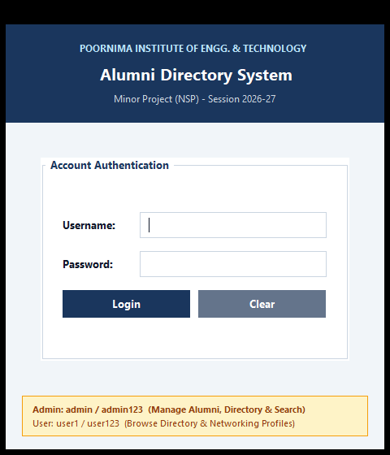
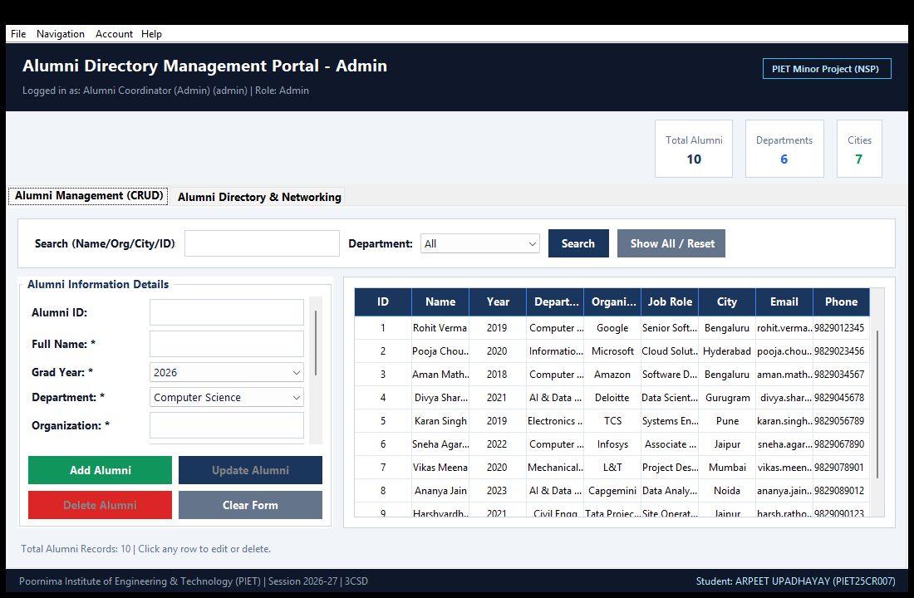
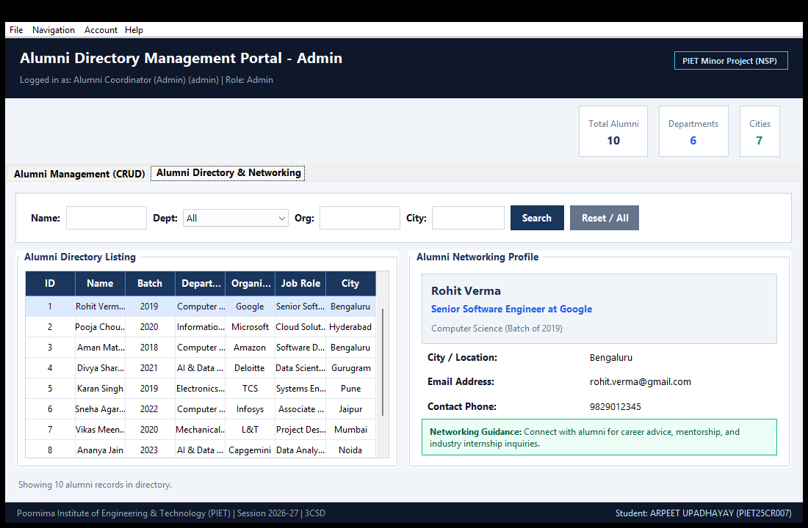
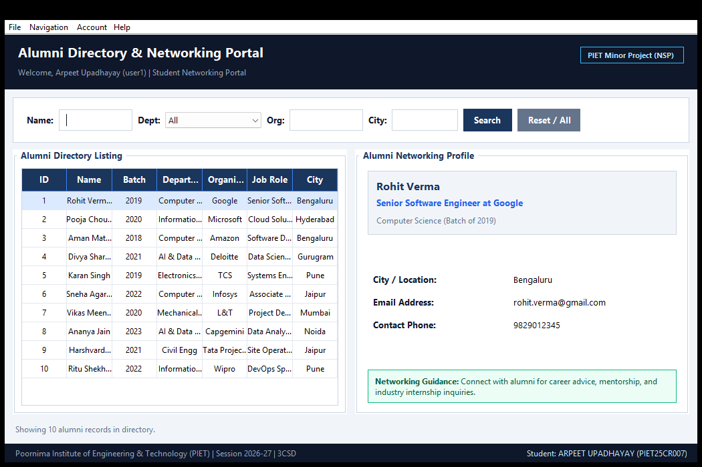
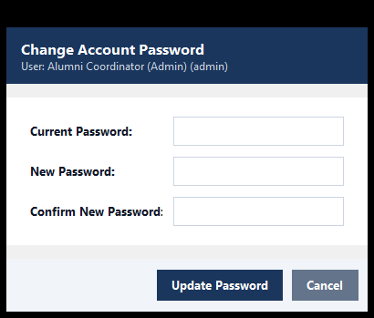
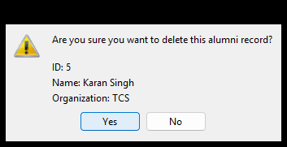

# Alumni Directory & Networking Management System
### B.Tech II Year – III Semester Minor Project (NSP)
**Department of Computer Science & Engineering**  
**Poornima Institute of Engineering & Technology (PIET), Jaipur**  
**Academic Session:** 2026–27 | **Section:** 3CSD  

---

## Student Details
- **Student Name:** ARPEET UPADHAYAY  
- **Student ID:** PIET25CR007  
- **Course:** B.Tech Computer Science & Engineering (II Year – III Sem)  
- **Project Scheme:** Minor Project (NSP)  
- **Institution:** Poornima Institute of Engineering & Technology (PIET)  

---

## 1. Project Overview
The **Alumni Directory & Networking Management System** is a desktop-based software solution engineered to streamline graduate tracking, institutional record management, and student-alumni networking for engineering colleges. Developed strictly adhering to the PIET Minor Project guidelines, the system uses core Java Swing, JDBC, and MySQL.

The application provides two clear user roles:
1. **Admin (Alumni Coordinator):** Full CRUD operations on alumni records (Add, View, Update, Delete with confirmation, Search), real-time department/city summary metrics, and password management.
2. **User / Student:** Interactive directory browsing, multi-criteria filtering (by Name, Department, Organization, and City), and an itemized "Alumni Networking Profile" card for career mentorship outreach.

---

## 2. Approved Technology Stack
- **Core Language:** Java (JDK 17 LTS / OpenJDK 26)
- **GUI Framework:** Java Swing (`JFrame`, `JPanel`, `JTable`, `JScrollPane`, `JTabbedPane`, `JButton`, `JOptionPane`, `GridBagLayout`, `BorderLayout`)
- **Persistence:** JDBC with parameterized `PreparedStatement`
- **Database:** MySQL Server 8.0+ / 8.4+ (InnoDB Engine)
- **Database Driver:** MySQL Connector/J 8.4.0 (`lib/mysql-connector-j-8.4.0.jar`)
- **IDE:** IntelliJ IDEA (Community or Ultimate Edition)

> **PIET Compliance Note:** Strictly desktop-based. No web frameworks (Spring Boot, Node.js, React), no cloud services, no external social media APIs (e.g. LinkedIn API), and no unnecessary bloatware.

---

## 3. Demo Credentials (For Viva & Evaluation)

| Role | Username | Password | Full Name / Description | Permissions |
|---|---|---|---|---|
| **Admin** | `admin` | `admin123` | System Administrator | Full Alumni CRUD, Metric Cards, Search, Change Password |
| **User (Student)** | `user1` | `user123` | Arpeet Upadhayay | Browse Directory, Multi-Field Search, View Networking Profile |
| **User (Student)** | `user2` | `user123` | Rohan Sharma | Student Directory & Networking Portal |
| **User (Student)** | `user3` | `user123` | Priya Verma | Student Directory & Networking Portal |

---

## 4. Key Features & Functionality

### 1. Secure Role-Based Authentication
- Clean Swing `LoginFrame` with credentials validation.
- Empty field detection and database connection health alerts.
- Role-based redirection (`AdminDashboardFrame` or `UserDashboardFrame`).
- Embedded credentials helper for viva demonstration.

### 2. Alumni Record Management (Admin CRUD)
- **Create:** Add new alumni with Name, Graduation Year, Department, Organization, Job Role, City, Email, and Phone.
- **Read:** Display all records in an interactive `JTable` hosted inside `JScrollPane` with custom-rendered Navy headers.
- **Update:** Selecting any table row populates the form; modify fields and save changes to MySQL.
- **Delete Safeguard:** Explicit confirmation dialog ("Are you sure you want to delete alumni record: '...'?") before deletion.
- **Quick Search:** Instant keyword filter across name, organization, and city.

### 3. Multi-Criteria Directory Search (Student Portal)
- Simultaneous four-field filtering:
  - **Name:** Partial text match
  - **Department:** Dropdown filter (All, CSE, AI & DS, IT, ECE, EE, ME, Civil)
  - **Organization:** Partial company match (e.g., Google, Microsoft, Amazon)
  - **City:** Partial location match (e.g., Bengaluru, Pune, Hyderabad, Jaipur)
- Single-click **Reset** button restoring the complete directory catalog.

### 4. Alumni Networking Profile Card
- Selecting any row in the directory displays a detailed professional card on the right panel.
- Shows Full Name, Graduation Batch, Department, Employer, Designation, City, Email, and Phone number.
- Designed specifically for student career guidance and mentorship inquiries.

### 5. Summary Metrics Cards (Admin)
- Real-time stat cards on the Admin dashboard:
  - **Total Alumni Registered**
  - **Distinct Departments**
  - **Active Placement Cities**

### 6. Account Security & Session Management
- Modal `ChangePasswordDialog` with old password verification.
- Safe logout mechanism clearing user session and returning to the login window.

---

## 5. Live Application Screenshots

All screenshots were captured directly from the live compiled application and are stored in `screenshots/`:

| Screenshot | Description | Preview |
|---|---|---|
| **01_login_screen.png** | Application Login Window with Credentials Box |  |
| **02_admin_dashboard.png** | Admin Dashboard Overview with Quick Metrics Cards |  |
| **03_manage_alumni_crud.png** | Admin Manage Alumni Panel with Form & Table |  |
| **04_alumni_directory_search.png** | Admin Directory Search & Profile Inspector |  |
| **05_user_dashboard_directory.png** | Student Dashboard with Search Filters & Directory |  |
| **06_user_alumni_details_view.png** | Student Networking Profile Card View |  |
| **07_change_password_dialog.png** | Modal Password Change Dialog with Verification |  |
| **08_delete_confirmation_dialog.png** | Deletion Confirmation Safety Dialog |  |

---

## 6. Automated Verification Test Suite

The project includes an automated programmatic test runner (`src/TestRunner.java`) verifying all 22 PIET mandatory test cases:

```
================================================================================
     PIET MINOR PROJECT (NSP) - AUTOMATED VERIFICATION TEST RUNNER              
     Project: Alumni Directory & Networking Management System                   
     Student: ARPEET UPADHAYAY (PIET25CR007) | Section: 3CSD                    
================================================================================

[PASS] TEST 01: Admin login                                | Admin authenticated successfully: Alumni Coordinator (Admin)
[PASS] TEST 02: User login                                 | Student authenticated successfully: Arpeet Upadhayay
[PASS] TEST 03: Invalid login rejection                    | Correctly rejected invalid credentials
[PASS] TEST 04: Empty login fields handling                | Correctly rejected empty username/password
[PASS] TEST 05: Add alumni record (CRUD - Create)          | Added successfully with generated ID: 12
[PASS] TEST 06: View alumni records (CRUD - Read)          | Retrieved 11 alumni records from database
[PASS] TEST 07: Search by alumni name                      | Found 1 alumni matching name 'Rohit'
[PASS] TEST 08: Search by department                       | Found 4 alumni in 'Computer Science'
[PASS] TEST 09: Search by organization                     | Found 1 alumni working at 'Google'
[PASS] TEST 10: Search by city                             | Found 3 alumni located in 'Bengaluru'
[PASS] TEST 11: Update alumni record (CRUD - Update)       | Updated organization and city, verified in MySQL
[PASS] TEST 12: Delete alumni record (CRUD - Delete)       | Deleted ID 12 and verified absence in MySQL
[PASS] TEST 13: Delete confirmation safeguard              | Confirmed: Action safely aborted when confirmation is cancelled
[PASS] TEST 14: Invalid graduation year validation         | Validated: Rejected years outside 1990-2026 range
[PASS] TEST 15: Invalid email validation                   | Validated: Format rejected for emails lacking '@' or '.'
[PASS] TEST 16: Invalid phone validation                   | Validated: Non-numeric or short phone numbers correctly rejected
[PASS] TEST 17: Empty required field validation            | Validated: Rejection enforced when required fields are blank
[PASS] TEST 18: Database connection health                 | Connected to MySQL alumni_db successfully
[PASS] TEST 19: Change password functionality              | Password updated, verified, and safely restored to original demo state
[PASS] TEST 20: Logout session handling                    | Session cleared and memory context de-referenced
[PASS] TEST 21: Restart application and login again        | Clean connection obtained; both Admin and User authenticated
[PASS] TEST 22: Verify database persistence                | Verified MySQL persistence: 10 alumni across 6 depts and 7 cities

================================================================================
     TEST EXECUTION SUMMARY: 22 PASSED, 0 FAILED (TOTAL: 22)        
================================================================================
>> ALL 22 PIET MANDATORY TESTS PASSED SUCCESSFULLY! <<
```

---

## 7. How to Setup and Run the Project

### Prerequisites
1. **Java Development Kit:** JDK 17+ or OpenJDK 26 installed and added to `PATH`.
2. **MySQL Server:** MySQL Server 8.0+ or 8.4+ running on port `3306`.
3. **Database Initialization:**
   Open MySQL Workbench or MySQL Command Line Client and run:
   ```sql
   source /path/to/sql/schema.sql;
   ```
   *(Or copy-paste the contents of `sql/schema.sql` into MySQL Workbench and execute).*

### Method 1: Using IntelliJ IDEA (Recommended)
1. Launch **IntelliJ IDEA**.
2. Click **Open** and select this directory: `c:\Users\mohdi\Downloads\NSP project 001`.
3. Verify that `lib/mysql-connector-j-8.4.0.jar` is configured as a Project Library (already linked in `AlumniDirectory.iml`).
4. Open `src/Main.java` and click the green **Run** arrow.

### Method 2: Using One-Click Batch Script (Windows)
Double-click `compile_and_run.bat` or run from Command Prompt:
```cmd
compile_and_run.bat
```

### Method 3: Using PowerShell Script
Open PowerShell in the project root:
```powershell
.\compile_and_run.ps1
```

### Method 4: Running the Automated Test Suite
```cmd
java -cp "bin;lib\mysql-connector-j-8.4.0.jar" TestRunner
```

---

## 8. Project Structure
```
NSP project 001/
├── .idea/                             # IntelliJ IDEA configuration
│   ├── modules.xml
│   └── runConfigurations/Main.xml
├── bin/                               # Compiled Java bytecode (.class files)
├── docs/                              # PIET Academic Documentation
│   ├── 01_PROJECT_PROPOSAL.md
│   ├── 02_SOFTWARE_REQUIREMENTS_SPECIFICATION_SRS.md
│   ├── 03_DATABASE_DESIGN_AND_SCHEMA.md
│   ├── 04_FLOWCHARTS_AND_SYSTEM_ARCHITECTURE.md
│   ├── 05_PRODUCT_BACKLOG_AND_SPRINTS.md
│   ├── 06_PIET_14_WEEK_DEVELOPMENT_LOG.md
│   ├── 07_TESTING_DOCUMENTATION_AND_TEST_CASES.md
│   └── 08_FINAL_PIET_PROJECT_REPORT.md
├── lib/
│   └── mysql-connector-j-8.4.0.jar    # JDBC MySQL 8.4 Driver
├── screenshots/                       # 8 Verified UI Screenshots
│   ├── 01_login_screen.png
│   ├── 02_admin_dashboard.png
│   ├── 03_manage_alumni_crud.png
│   ├── 04_alumni_directory_search.png
│   ├── 05_user_dashboard_directory.png
│   ├── 06_user_alumni_details_view.png
│   ├── 07_change_password_dialog.png
│   └── 08_delete_confirmation_dialog.png
├── sql/
│   └── schema.sql                     # Database DDL & Seed Data
├── src/                               # Java Source Code
│   ├── db/
│   │   └── DBConnection.java          # JDBC Connection Manager with Fallbacks
│   ├── model/
│   │   ├── User.java                  # User Model
│   │   └── Alumni.java                # Alumni Model
│   ├── dao/
│   │   ├── UserDAO.java               # Authentication & User DAO
│   │   └── AlumniDAO.java             # Alumni CRUD, Multi-Filter & Metrics DAO
│   ├── ui/
│   │   ├── UIStyle.java               # Academic Styling & Custom Table Renderers
│   │   ├── LoginFrame.java            # Desktop Login Window
│   │   ├── AdminDashboardFrame.java   # Admin Management Dashboard
│   │   ├── ManageAlumniPanel.java     # Admin Alumni CRUD & Form Panel
│   │   ├── AlumniDirectoryPanel.java  # Student/Admin Directory Search & Profiles
│   │   ├── UserDashboardFrame.java    # Student Portal
│   │   ├── ChangePasswordDialog.java  # Modal Password Change
│   │   └── ScreenshotGenerator.java   # Automated Headless GUI Capture
│   ├── Main.java                      # Application Entry Point
│   └── TestRunner.java                # 22-Point PIET Verification Suite
├── AlumniDirectory.iml                # IntelliJ Module Descriptor
├── compile_and_run.bat                # Windows CMD compile & launch script
├── compile_and_run.ps1                # PowerShell compile & launch script
└── README.md                          # Comprehensive Documentation
```
