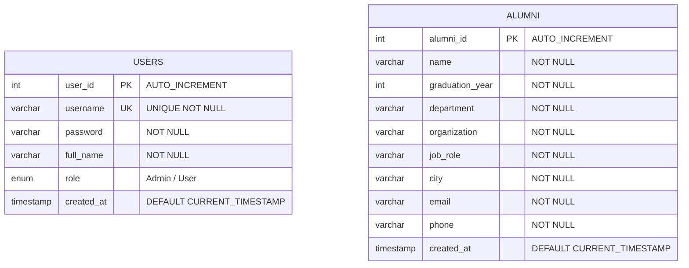

# Database Design and Schema Specification

**Project Title:** Alumni Directory & Networking Management System  
**Database Name:** `alumni_db`  
**Database Engine:** MySQL Server 8.0+ / 8.4+ (InnoDB Engine)  
**Student Name:** ARPEET UPADHAYAY (PIET25CR007)  
**Session:** 2026–27 | **Section:** 3CSD  
**College:** Poornima Institute of Engineering & Technology (PIET)  

---

## 1. Database Architecture & Design Principles

The database for the Alumni Directory & Networking Management System is designed adhering to the Third Normal Form (3NF) to eliminate data redundancy, prevent modification anomalies, and enforce strict relational integrity.

Key structural principles include:
1. **Normalization:** User credentials/roles and alumni records are segregated into distinct relational entities.
2. **Entity Independence:** The `alumni` table functions as an authoritative master registry of graduated students across all departments and graduating batches.
3. **Role-Based Authentication:** The `users` table governs role-based desktop access (`Admin` vs `User`) with unique username constraints.
4. **Data Integrity & Auditing:** Auto-incrementing primary keys (`user_id`, `alumni_id`) guarantee unique record identity, while timestamps track record creation.

---

## 2. Entity-Relationship (ER) Diagram



---

## 3. Data Dictionary

### 3.1 Table: `users`
Stores credentials and system roles for application access.

| Column Name | Data Type | Constraints | Default | Description |
|---|---|---|---|---|
| `user_id` | `INT` | `PRIMARY KEY, AUTO_INCREMENT` | — | Unique internal user identifier |
| `username` | `VARCHAR(50)` | `NOT NULL, UNIQUE` | — | Login username identifier |
| `password` | `VARCHAR(255)` | `NOT NULL` | — | User authentication password |
| `full_name` | `VARCHAR(100)` | `NOT NULL` | — | Full display name of the user |
| `role` | `ENUM('Admin', 'User')` | `NOT NULL` | `'User'` | Access role determining dashboard UI |
| `created_at` | `TIMESTAMP` | `DEFAULT CURRENT_TIMESTAMP` | `CURRENT_TIMESTAMP` | Record creation timestamp |

### 3.2 Table: `alumni`
Stores professional, educational, and contact details of college alumni.

| Column Name | Data Type | Constraints | Default | Description |
|---|---|---|---|---|
| `alumni_id` | `INT` | `PRIMARY KEY, AUTO_INCREMENT` | — | Unique alumni record ID |
| `name` | `VARCHAR(100)` | `NOT NULL` | — | Full name of the alumni |
| `graduation_year` | `INT` | `NOT NULL` | — | Year of graduation from PIET (e.g. 2020) |
| `department` | `VARCHAR(100)` | `NOT NULL` | — | Academic department (CSE, AI & DS, etc.) |
| `organization` | `VARCHAR(150)` | `NOT NULL` | — | Current employer / organization |
| `job_role` | `VARCHAR(100)` | `NOT NULL` | — | Current professional designation |
| `city` | `VARCHAR(100)` | `NOT NULL` | — | Current working city / location |
| `email` | `VARCHAR(100)` | `NOT NULL` | — | Professional / contact email address |
| `phone` | `VARCHAR(20)` | `NOT NULL` | — | Contact telephone / mobile number |
| `created_at` | `TIMESTAMP` | `DEFAULT CURRENT_TIMESTAMP` | `CURRENT_TIMESTAMP` | Record creation timestamp |

---

## 4. SQL DDL Statements

The complete SQL DDL schema script used to generate `alumni_db` is defined below:

```sql
-- Create Database
CREATE DATABASE IF NOT EXISTS alumni_db;
USE alumni_db;

-- 1. Users Table
CREATE TABLE IF NOT EXISTS users (
    user_id INT AUTO_INCREMENT PRIMARY KEY,
    username VARCHAR(50) NOT NULL UNIQUE,
    password VARCHAR(255) NOT NULL,
    full_name VARCHAR(100) NOT NULL,
    role ENUM('Admin', 'User') NOT NULL DEFAULT 'User',
    created_at TIMESTAMP DEFAULT CURRENT_TIMESTAMP
) ENGINE=InnoDB DEFAULT CHARSET=utf8mb4;

-- 2. Alumni Table
CREATE TABLE IF NOT EXISTS alumni (
    alumni_id INT AUTO_INCREMENT PRIMARY KEY,
    name VARCHAR(100) NOT NULL,
    graduation_year INT NOT NULL,
    department VARCHAR(100) NOT NULL,
    organization VARCHAR(150) NOT NULL,
    job_role VARCHAR(100) NOT NULL,
    city VARCHAR(100) NOT NULL,
    email VARCHAR(100) NOT NULL,
    phone VARCHAR(20) NOT NULL,
    created_at TIMESTAMP DEFAULT CURRENT_TIMESTAMP
) ENGINE=InnoDB DEFAULT CHARSET=utf8mb4;
```

---

## 5. Seed Data for Evaluation & Viva Demo

```sql
-- Initial Users (1 Admin, 3 Students)
INSERT INTO users (username, password, full_name, role) VALUES
('admin', 'admin123', 'System Administrator', 'Admin'),
('user1', 'user123', 'Arpeet Upadhayay', 'User'),
('user2', 'user123', 'Rohan Sharma', 'User'),
('user3', 'user123', 'Priya Verma', 'User');

-- Initial Alumni Records across batches, departments, organizations, and cities
INSERT INTO alumni (name, graduation_year, department, organization, job_role, city, email, phone) VALUES
('Rahul Sharma', 2020, 'Computer Science & Engineering', 'Google India', 'Senior Software Engineer', 'Bengaluru', 'rahul.sharma@google.com', '9876543210'),
('Priya Patel', 2021, 'Computer Science & Engineering', 'Microsoft', 'Software Engineer II', 'Hyderabad', 'priya.patel@microsoft.com', '9876543211'),
('Amit Kumar', 2019, 'Information Technology', 'Amazon AWS', 'Cloud Solutions Architect', 'Bengaluru', 'amit.kumar@amazon.com', '9876543212'),
('Sneha Gupta', 2022, 'Artificial Intelligence & Data Science', 'NVIDIA', 'Machine Learning Engineer', 'Pune', 'sneha.gupta@nvidia.com', '9876543213'),
('Vikas Meena', 2020, 'Electronics & Communication', 'Qualcomm', 'Hardware Design Engineer', 'Bengaluru', 'vikas.meena@qualcomm.com', '9876543214'),
('Ananya Joshi', 2021, 'Computer Science & Engineering', 'Adobe Systems', 'Member Technical Staff', 'Noida', 'ananya.joshi@adobe.com', '9876543215'),
('Deepak Verma', 2018, 'Mechanical Engineering', 'Tata Motors', 'Product Design Lead', 'Pune', 'deepak.verma@tatamotors.com', '9876543216'),
('Pooja Choudhary', 2023, 'Computer Science & Engineering', 'Infosys Ltd', 'Systems Engineer Specialist', 'Jaipur', 'pooja.choudhary@infosys.com', '9876543217'),
('Gaurav Singh', 2022, 'Civil Engineering', 'Larsen & Toubro', 'Senior Project Engineer', 'Mumbai', 'gaurav.singh@larsentoubro.com', '9876543218'),
('Neha Sharma', 2020, 'Artificial Intelligence & Data Science', 'Flipkart', 'Data Scientist', 'Bengaluru', 'neha.sharma@flipkart.com', '9876543219');
```
