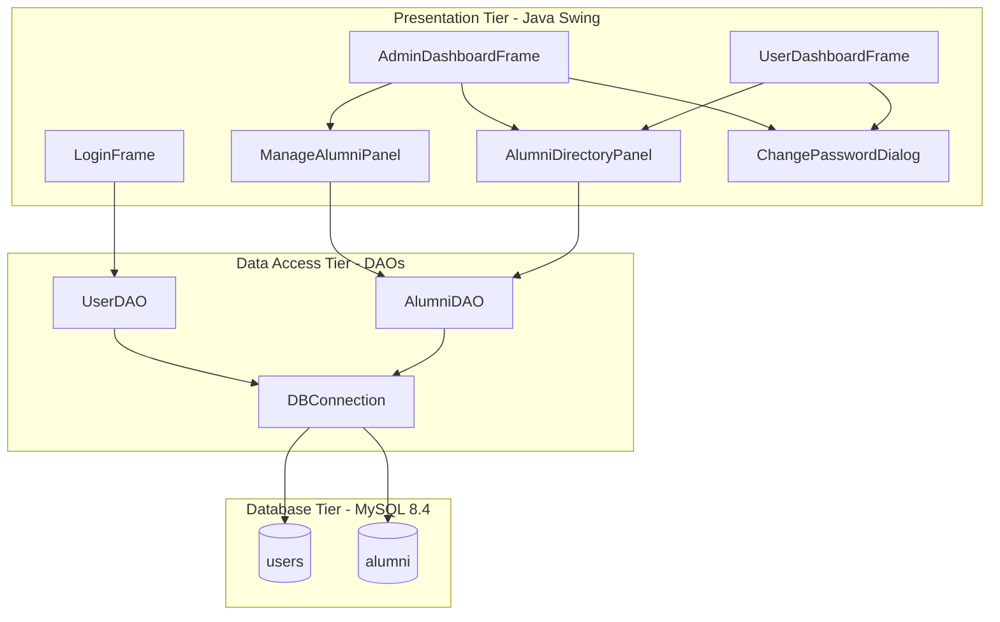
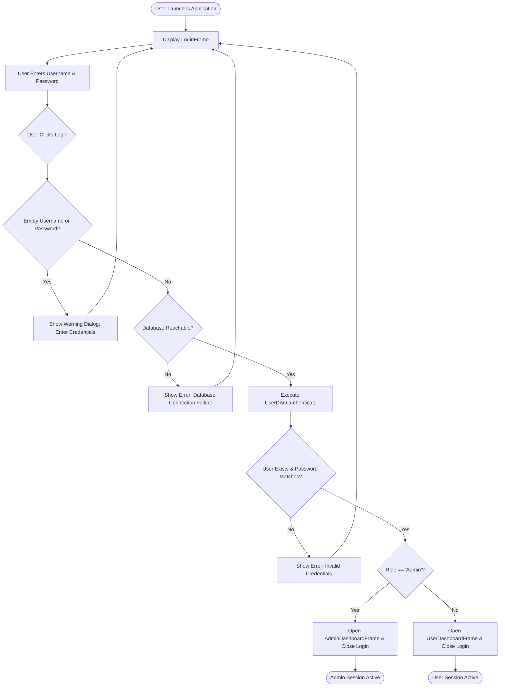
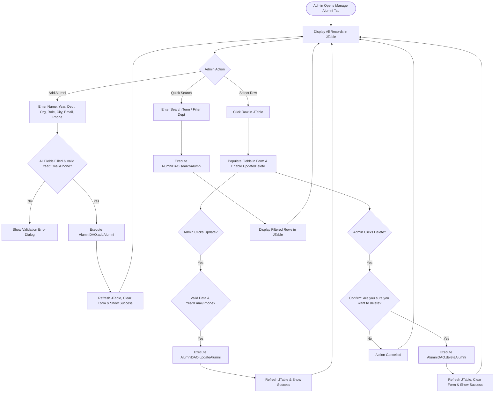
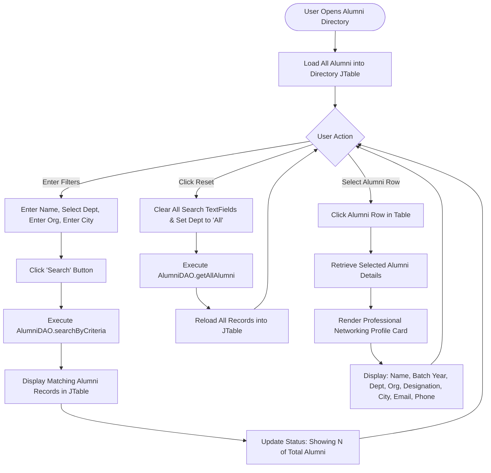
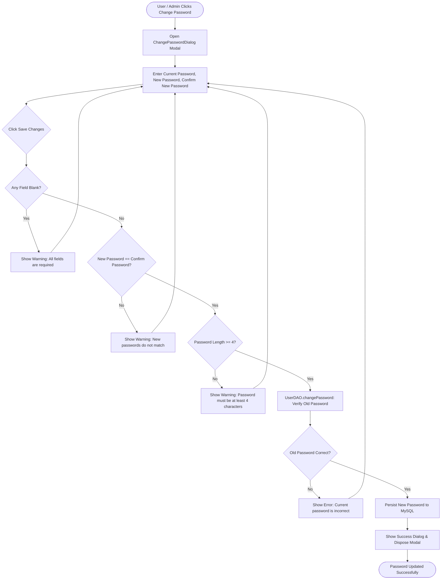

# Flowcharts and System Architecture

**Project Title:** Alumni Directory & Networking Management System  
**Document Code:** PIET-NSP-ARCH-04  
**Student Name:** ARPEET UPADHAYAY (PIET25CR007)  
**Session:** 2026–27 | **Section:** 3CSD  
**College:** Poornima Institute of Engineering & Technology (PIET)  

---

## 1. System Architecture

The application adopts a clean, three-tier modular architectural pattern:
1. **Presentation Layer (Swing GUI):** Desktop frames, panels, custom tables, form inputs, and dialogs (`LoginFrame`, `AdminDashboardFrame`, `UserDashboardFrame`, `ManageAlumniPanel`, `AlumniDirectoryPanel`, `ChangePasswordDialog`).
2. **Data Access Layer (DAO Pattern):** Java classes encapsulating database queries (`UserDAO`, `AlumniDAO`, `DBConnection`) using parameterized `PreparedStatement`.
3. **Data Storage Layer (MySQL Database):** Relational tables hosted locally (`alumni_db` with `users` and `alumni` tables).

---

## 2. Authentication & Role Routing Flowchart

---

## 3. Alumni Record Management Flowchart (Admin CRUD)

---

## 4. Multi-Criteria Directory Search & Networking Profile Flowchart

---

## 5. Account Password Change Flowchart

